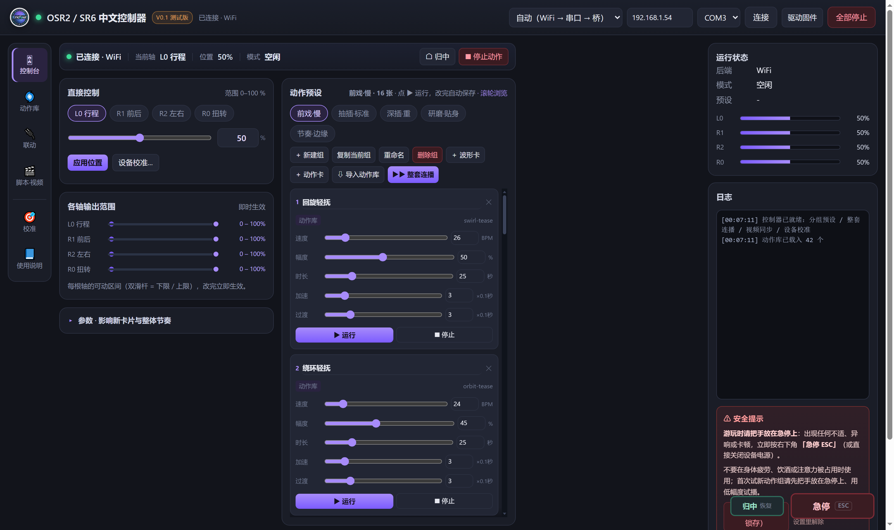
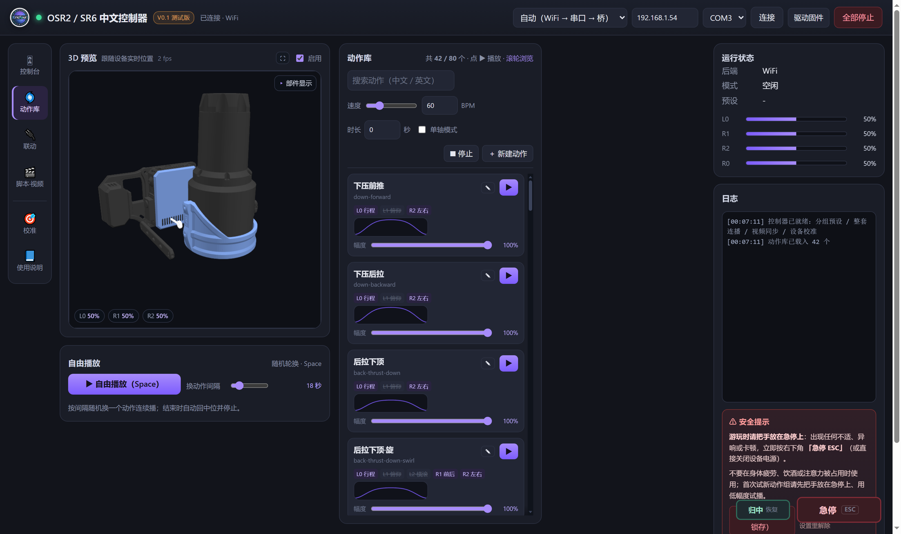
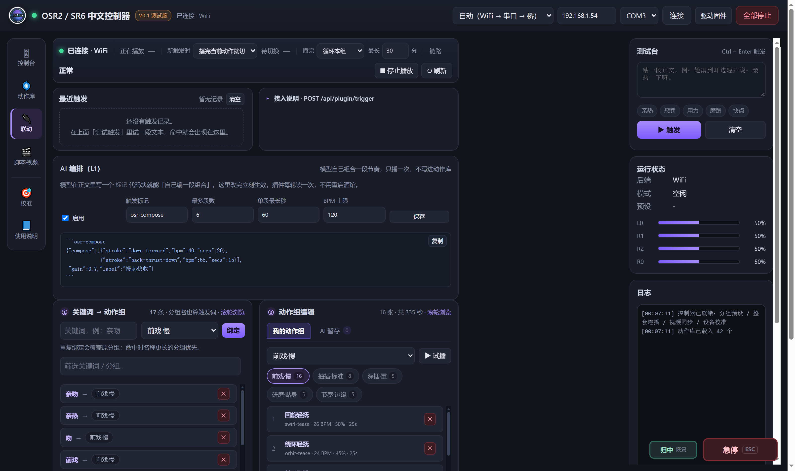
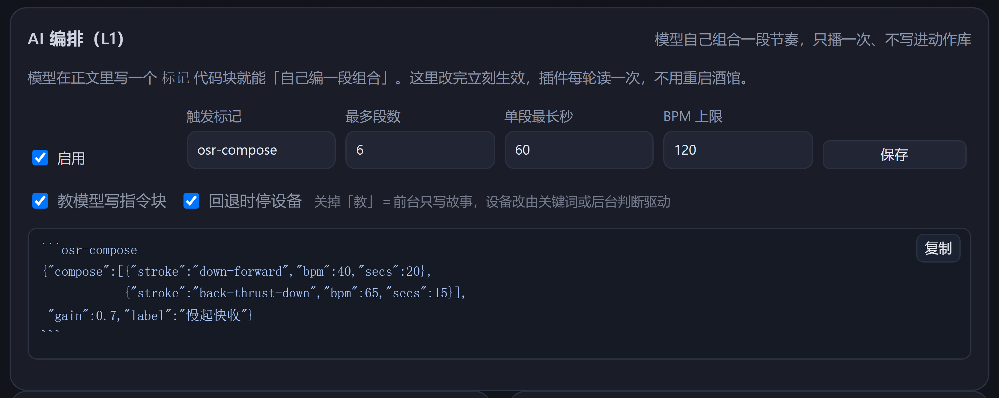
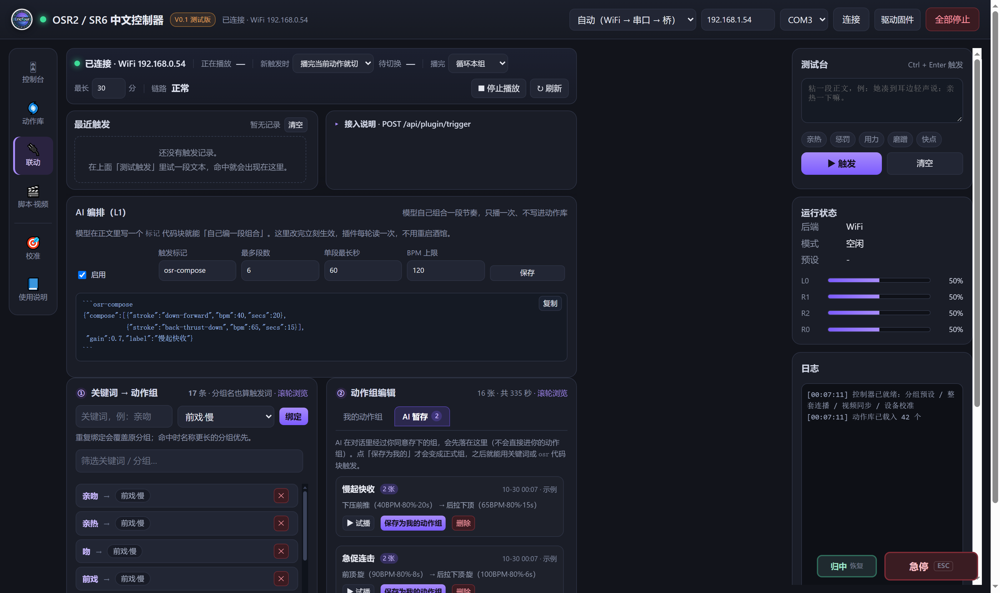
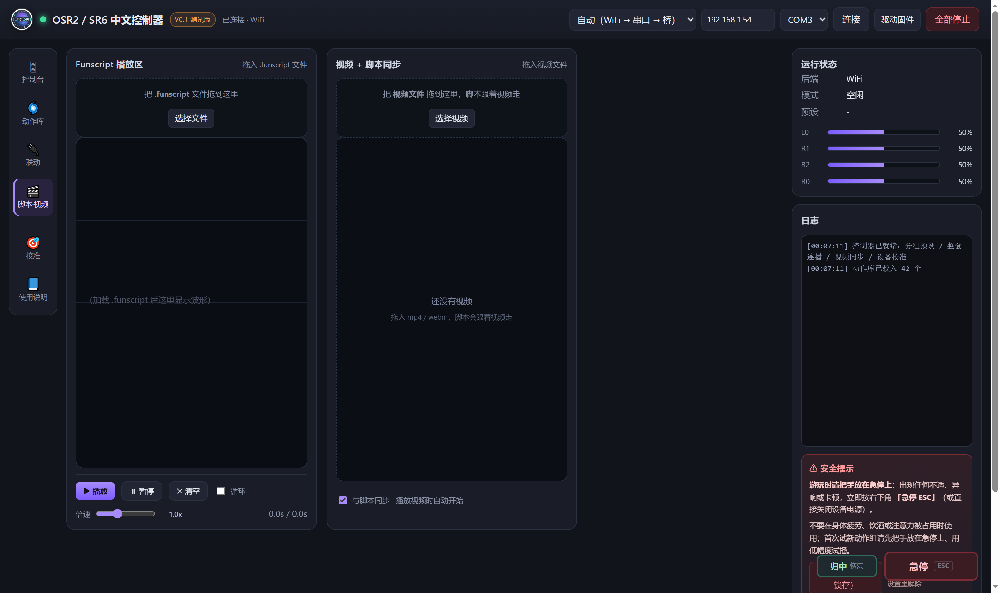
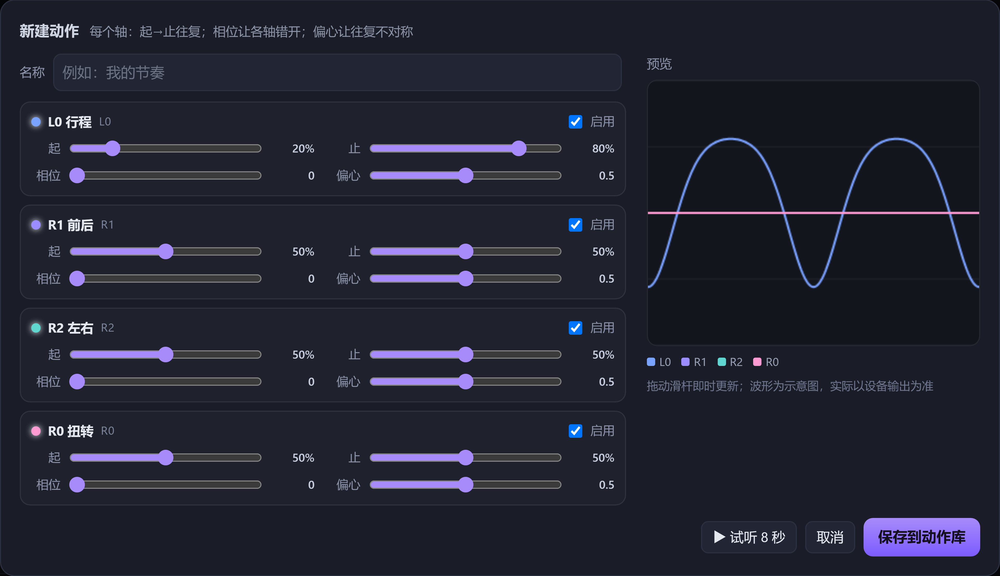
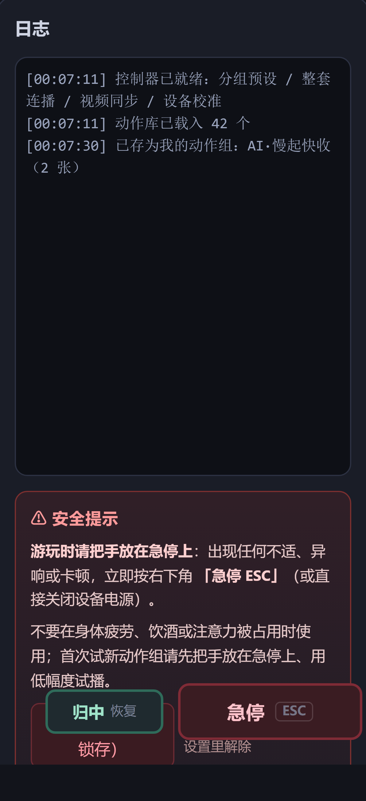

# DSH Tavern-TCodeESP32 Controller

**OSR2 / SR6 中文控制器**：跑在本地电脑上的网页控制器，内置动作库，可当普通播放器用，
也可以接上 **DSH Tavern**，让角色卡的文字直接驱动设备。
设备通过 **TCode 协议**走 WiFi / 串口 / 桥（ESP32 固件同样适用）。

> **🧪 测试版 V0.1**
> 功能仍在变动，可能有 bug 或行为变化。**请先小幅度、短时间测试**，确认设备运行正常、
> 动作组没顶到行程，再正式游玩（第一次建议 ≤30% 幅度、单段 ≤10 秒）。
>
> 配套酒馆本体：**[dsh-tavern](https://github.com/flizzywine/dsh-tavern)**（插件装在它里面；
> 控制器本身不依赖 Tavern，不开酒馆也能单独当播放器用）。

> **⚠️ 成人内容警告（18+）**
> 本仓库包含面向成年人的性内容相关功能与示例。未满 18 岁请勿使用。
> 仓库中的示例卡片均为虚构角色扮演，不涉及任何真实人物。
>
> **⚠️ 硬件安全警告**
> 这是**控制真实机械装置运动**的软件。使用前请读完 [安全与注意事项](#安全与注意事项)，
> 并在手边随时可按到**急停**。作者不对任何人身伤害、设备损坏或数据丢失负责。

---

## 这是什么

| | 说明 |
|---|---|
| 本体 | Python 3（只用标准库）写的本地 HTTP 服务 + 一套原生 JS 的网页界面 |
| 设备 | 通过 **WiFi（TCode WebSocket）**、**串口** 或 **TCode 桥（127.0.0.1:7777）** 连接 |
| 动作 | 内置 42 个 Tempest 动作，可自建、可改、可保存成动作组 |
| 联动 | 关键词 / 代码块触发动作组，带打断、循环、AI 编排与 AI 暂存 |
| 插件 | 配套 DSH Tavern 插件 `dsh-osr-device`，正文里的指令块直接驱动设备 |
| 3D | 原生 WebGL 实时预览设备姿态（无第三方引擎） |

**它不做的事**：不内置任何模型服务、不联网、不收集数据；所有请求都在本机。

---

## 功能一览

- **控制台**：连接设备、手动播放、参数调节、运行状态、日志、安全提示与急停
- **动作库**：42 个内置动作 + 自建动作（上限 80）；新建 / 编辑曲线 / 还原 / 删除 / 试听
- **联动**：动作组编辑（增删改、复制、重命名）、关键词绑定、试播
  - **打断方式**：播完当前动作再切 / 整组播完再切 / 立刻切
  - **播完循环**：停止 / 循环本组 / 循环并换组（可设最长分钟数）
  - **AI 编排**：模型自己拼一段组合，只播一次；标记与上限可在界面改
  - **AI 暂存**：模型经你同意存下的组先落在这里，你点「保存为我的动作组」才生效
- **脚本·视频**：拖入 `.funscript` 播放，循环、倍速
- **校准**：轴映射、行程范围、速度上限
- **使用说明**：应用内自带一份完整说明书（侧栏最后一页）
- **安全**：急停（锁存）、全部停止（`Esc`）、安全行程限制、看门狗

---

## 环境要求

| 项 | 要求 |
|---|---|
| 系统 | Windows 10 / 11（脚本是 `.bat`；服务端本身跨平台） |
| Python | 3.8+（无需 `pip install`，只用标准库） |
| 浏览器 | Chrome / Edge / Firefox 较新版本（需要 WebGL） |
| 设备 | OSR2、SR6 或其他支持 TCode v0.4 的设备，且已连上同一局域网 |

---

## 快速开始

1. **启动**：双击 `启动控制器（后台常驻）.bat`
   - 浏览器会自动打开 `http://127.0.0.1:8899`
   - 只想临时开一次：双击 `启动控制器.bat`（窗口关掉就停）
   - 想让手机在同一 WiFi 下访问：双击 `启动控制器（手机可访问）.bat`
2. **连接设备**：顶部选「自动（WiFi → 串口 → 桥）」，填设备 IP，点「连接」
   - 不知道 IP？先试串口，或先用你路由器后台看一下
   - 连不上会显示原因，`server.log` 里有更详细的记录
3. **试一下**：在「动作库」点任意动作的 ▶，或在「联动」点「▶ 试播」放整组

停止：点顶部「全部停止」，或按 `Esc`（等于急停）。

> 控制器是独立进程：关掉浏览器页面不影响它，DSH 重启也不影响它。
> 需要彻底停止就双击 `停止控制器.bat`，或结束 `pythonw.exe`。

---

## 界面

### 控制台
连接与手动播放的主界面。参数（幅度、速度、行程）在这里调，
右下角有「运行状态」和「日志」，日志下方是**安全提示**与**急停**。

### 动作库
- 每个动作是一张卡：中文名 + 英文 id + 涉及轴 + 曲线缩略图 + 幅度滑杆
- `✎` 改曲线（内置动作也能改，改的是"覆盖层"，`↺` 可一键还原）
- `✕` 删除自建动作（内置动作不能删）
- 上限 **80** 个（42 内置 + 最多 38 个自建），到顶会拒绝新建
- 右上角有 3D 预览，实时跟着设备姿态动

### 联动
- **① 关键词 → 动作组**：正文里出现关键词就触发对应组；组名本身也算触发词
- **② 动作组编辑**：两组标签页——「我的动作组」和「AI 暂存」
  - 可以加入动作、调 BPM/幅度/时长，新建 / 复制 / 重命名 / 删除组
  - 「AI 暂存」里是模型经你同意存下来的组，点「保存为我的动作组」才转正
- **AI 编排（L1）**：模型可以自己拼一段组合只播一次，不写入动作库；
  触发标记、段数上限、单段最长、BPM 上限都在这里改
- 顶部条：连接状态、当前播放、打断方式、播完循环、测试台

### 脚本·视频
把 `.funscript` 拖到虚线框里即可播放，可循环、可调倍速。

### 校准
按你的设备调轴映射与行程。OSR2 一般用 `L0 / R1 / R2`；
四轴都动说明固件支持多轴，属正常。

---

## 玩法：让文字驱动设备

三种触发方式，按确定性从高到低：

1. **代码块（推荐）**——正文里写：

   ````text
   ```osr
   {"group":"前戏·慢"}
   ```
   ````

   一轮里写多个块 = 连播；带 `"bpm":80` 可临时指定速度。
2. **关键词**——正文里出现绑定的关键词（如"亲热"）就播放对应组。
3. **AI 编排**——模型自己组合一段动作：

   ````text
   ```osr-compose
   {"compose":[{"stroke":"down-forward","bpm":40,"secs":20},
               {"stroke":"back-thrust-down","bpm":65,"secs":15}],
    "gain":0.7,"label":"慢起快收"}
   ```
   ````

   只播一次、不写入动作库。若同时写 `"save":"慢起快收"`，这一段会送进
   控制器「AI 暂存」，等你确认后才成为正式动作组。

**打断**：正在播 A，又来了 B——
- `播完当前动作再切`（默认）：B 等当前动作播完
- `整组播完再切`：B 等 A 整组播完
- `立刻切`：立刻停 A 播 B

**循环**：一轮对话结束后设备不该干停，所以有「播完」策略——
`停止 / 循环本组 / 循环并换组`，并可设最长分钟数（默认 30 分钟，到点自动停）。

---

## DSH Tavern 插件

插件在本仓库的 `plugins/dsh-osr-device/`，详细说明见 [plugins/README.md](plugins/README.md)。

1. 复制 `plugins/dsh-osr-device/` 整个文件夹到 `~/.dsh/profile-data/tavern/data/plugins/`
2. 重启 DSH，在「设置 → DSH Tavern → 插件」里确认已加载
3. 进游戏后，本局设置里打开 **允许模型自主决定动作**（否则组指令不执行，`stop` 除外）
4. 控制器没开时插件会静默跳过，正文照常，不会报错

插件会：把动作库清单与协议写进提示词、识别 `osr` / `osr-compose` 块、
一轮多个块时一次触发并进入轮换池、把播放进度暴露给卡片面板、
把 `save` 的编排送进「AI 暂存」。

---

## 安全与注意事项

**必读，按重要顺序：**

1. **手边随时能按到急停**。红色「急停」按钮会锁存——按下后所有运动指令被拒，
   直到你点「归中 恢复」（或 `Esc` 解锁流程）。
2. **无人看管时不要运行**。需要长时间连续播放时，用「播完循环」+ 最长分钟数
   设一个上限，而不是让它整晚跑。
3. **先用小幅度试**。新动作、新组、新设备，先把幅度滑到 30–40% 试一次，
   确认行程没顶死、线材没被拽住，再加大。
4. **注意行程与机械干涉**。软件里有安全行程（默认只允许 25%–75%）与速度上限，
   但真正的机械极限取决于你的整机与摆件——软件限制不能替代你的判断。
5. **不要在床上、枕边等无法立即脱身的位置使用**；不要在有其他人在场、
   无法中断的场合使用。
6. **身体不适立即停**：疼痛、麻木、头晕、心悸等，立刻急停并停止使用。
   有心血管疾病、癫痫、皮肤损伤、近期手术等情况请先咨询医生。
7. **本软件不联网**，但用它加载第三方动作文件（`.funscript`）时请确认文件来源。

---

## 常见问题

| 现象 | 处理 |
|---|---|
| 点「连接」失败 | 确认设备和电脑在同一 WiFi；先试串口；看 `server.log`；Windows 防火墙要允许 Python 访问网络 |
| 连上了但不动作 | 检查是否按过急停（锁存）；看右上「运行状态」；确认幅度不是 0 |
| 画面关掉后设备还在动 | 正常：控制器是独立进程。按 `Esc` 或「全部停止」，或双击 `停止控制器.bat` |
| 页面很卡 | 关掉 3D 预览（右侧「启用」勾选框），或用手机访问只当遥控器 |
| 手机打不开 | 用「启动控制器（手机可访问）.bat」，按窗口里显示的 `http://192.168.x.x:8899` 访问；防火墙要放行 |
| 改了动作没生效 | 浏览器 `Ctrl + F5` 强刷；动作库有缓存版本号 |
| 内置动作被改坏了 | 点动作卡上的 `↺` 还原 |
| 动作组播完就停 | 「联动」顶部「播完」选成「循环本组」；看门狗只在没开循环时才 10 秒自动停 |
| AI 编排没反应 | 控制器「联动 → AI 编排」要勾「启用」；动作名必须来自动作库英文名 |
| 卡片写的组名不存在 | 组名必须是「联动」里真实存在的组，一个字都不能编 |

---

## 目录结构

```text
OSR控制器/
├─ server.py              # 服务端（HTTP + 设备驱动 + 动作引擎），单文件
├─ wsclient.py            # 极简 WebSocket 客户端（WiFi 连设备用）
├─ static/                # 前端：index.html / app.js / style.css / device3d.js
│  ├─ device-osr2.bin     # 3D 预览用模型（来源见 THIRD-PARTY-NOTICES.md）
│  └─ logo.webp
├─ model-src/             # 3D 模型整理工具（Blender 脚本 + 打包脚本）
├─ strokes.json           # 42 个内置动作
├─ presets.json           # 动作组、打断方式、循环与 AI 编排配置
├─ keywords.json          # 关键词 → 动作组 绑定
├─ config.example.json    # 配置示例（复制成 config.json 用）
├─ plugins/               # DSH Tavern 插件（dsh-osr-device）
├─ examples/              # 接口联调示例（test_api.py / test_v2.py）
├─ *_start*.bat / *.ps1   # 启动、停止、检查状态
└─ 使用说明.txt            # 纯文本版说明（应用内也有「使用说明」页）
```

`config.json`、`limits.json`、`calibration.json`、`server.log`、`strokes_user.json`、
`ai_groups.json` 都是**本机私有数据**，已在 `.gitignore` 里排除，请不要提交。

---

## 截图

| | |
|---|---|
|  |  |
|  |  |
|  |  |
|  |  |

---

## 许可证与致谢

- **本项目代码**：MIT，见 [`LICENSE`](LICENSE)
- **动作参数与运动公式**：来自 [ayvajs](https://github.com/ayvasoftware/ayvajs)（MIT），
  见 [`LICENSE-ayvajs.txt`](LICENSE-ayvajs.txt)
- **3D 模型数据**：提取自 Ayva Stroker Lite 站点包并重新打包，仅作示意；
  **本项目不包含 OSR2 / SR6 的打印用 CAD / STL 文件**
- **OSR2 / SR6 / TCode**：硬件设计与固件、协议的权属归各自作者；
  本项目实现的是**客户端**，与官方无关联、无背书

第三方内容的完整说明见 [`THIRD-PARTY-NOTICES.md`](THIRD-PARTY-NOTICES.md)。
权利人若认为某处使用不妥，请联系作者，会立即移除相关文件。

---

## 参与

- 报问题请附：设备型号、连接方式、`server.log` 相关片段、复现步骤
- 提 PR 请保持"只用标准库"这个前提，前端不引入构建工具与第三方框架
